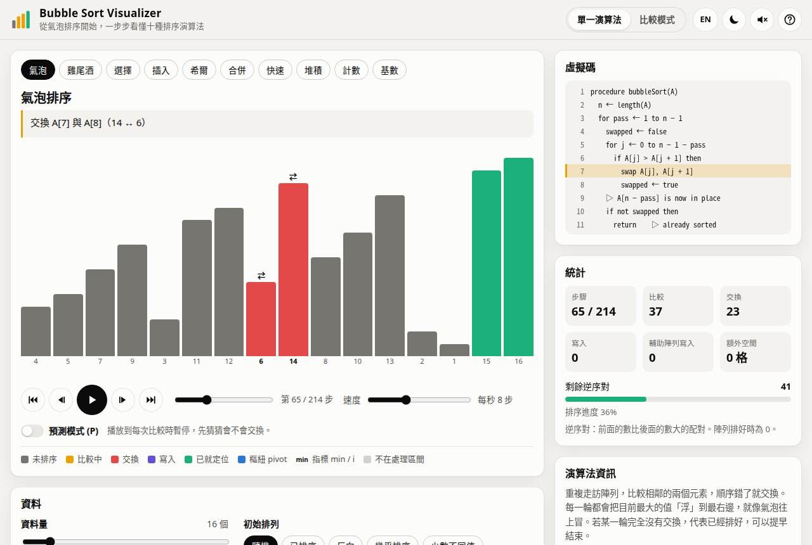
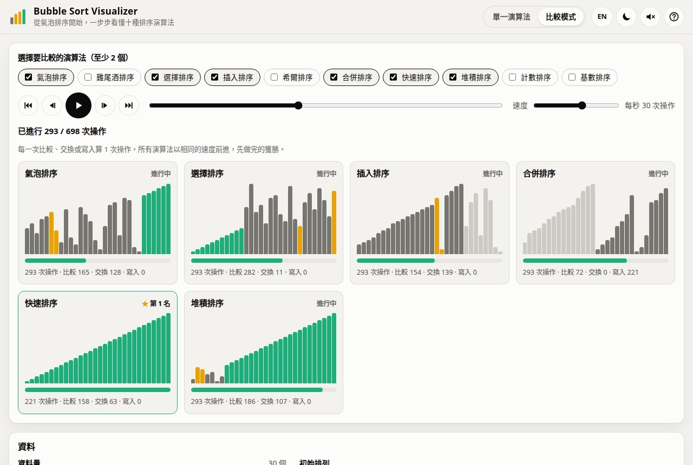

# Software Engineering Group 4：Bubble Sort Visualizer

軟體工程課程第 4 組的專題：在網頁上一步步呈現排序演算法的過程。原始版本（v1）是第 4 組的課程繳交作品，逐步顯示 Bubble Sort 的比較與交換；v2 是之後的延伸版本，以 Bubble Sort 為主角擴充成十種排序演算法的互動式教學工具，可以逐步播放與倒退、對照虛擬碼與統計數字、讓多個演算法比賽，並補上單元測試、CI 與設計文件。

網站：https://zxc29051617.github.io/Software-Engineering_group4/



## 功能

- 十種排序：氣泡、雞尾酒、選擇、插入、希爾、合併、快速、堆積、計數、基數排序
- 播放控制：播放／暫停、上一步／下一步、回到開頭／跳到結果、時間軸拖曳、速度每秒 0.5–800 步
- 資料：資料量 5–100，初始排列可選隨機、已排序、反向、幾乎排序、少數不同值
- 自訂資料：2–100 個 0–999 的整數，輸入錯誤時指出第幾個值、哪裡不對
- 虛擬碼標示目前執行的行，並以文字說明每一步在做什麼
- 統計：比較、交換、寫入次數、額外空間、剩餘逆序對與排序進度
- 演算法資訊：時間與空間複雜度，是否穩定、原地、自適應
- 合併、計數、基數排序會在長條圖下方顯示暫存陣列、計數陣列或桶子
- 比較模式：多個演算法排序同一組資料，以相同的操作速度競賽，最後列出名次與結果表
- 預測模式：比較時先猜會不會交換，再看答案與理由
- 分享連結：把模式、演算法與資料編進網址
- 鍵盤快捷鍵（按 `?` 查看）、繁體中文／英文、淺色／深色、手機版、減少動態效果、可選的音效



## 專案結構

```text
.
├── index.html                # 網頁入口（GitHub Pages 從 main 分支根目錄發布）
├── package.json              # npm test、npm run check
├── backend/                  # 排序核心：純 JavaScript，不依賴 DOM
│   ├── algorithms/           # 十種演算法，每個都是送出事件的 generator
│   ├── engine/               # 事件、狀態重播、播放器、比較模式時鐘、文字說明、軌跡驗證
│   └── input/                # 預設排列、可重現的亂數、自訂輸入檢查
├── frontend/
│   └── src/
│       ├── app.js            # 程式進入點
│       ├── style.css         # 版面、主題與長條顏色
│       ├── controllers/      # 單一演算法模式、比較模式
│       ├── components/       # 長條圖、虛擬碼、統計、演算法資訊、控制列、資料輸入
│       ├── services/         # 播放排程、音效、偏好設定、主題、分享連結、快捷鍵
│       ├── i18n/             # 繁體中文與英文字串
│       └── assets/           # 網站圖示
├── test/                     # node:test 單元測試
├── scripts/check.js          # 語法檢查、import 路徑與 index.html 引用檢查
├── docs/                     # 需求、架構、測試計畫、版本紀錄、截圖
├── ui-design/                # v1 的介面設計稿
└── .github/workflows/        # GitHub Actions：push 與 pull request 時執行檢查與測試
```

文件：[需求規格](docs/requirements.md)、[架構設計](docs/architecture.md)、[測試計畫](docs/test-plan.md)、[版本紀錄](docs/changelog.md)。

## 執行方式

網站使用 ES 模組，需透過 HTTP 開啟。在專案根目錄執行：

```bash
python3 -m http.server 8000
```

再用瀏覽器開啟 http://localhost:8000/ 。

## 測試

需要 Node.js 20 以上，不必安裝其他套件：

```bash
npm test          # 單元測試
npm run check     # 語法檢查、import 路徑與 index.html 引用檢查
```

## 作者

原始版本（v1）由軟體工程第 4 組完成：[zxc29051617](https://github.com/zxc29051617)、[jhih-weiwei](https://github.com/jhih-weiwei)、[960815anna-cmd](https://github.com/960815anna-cmd)。v2 是建立在 v1 設計與程式上的延伸版本；v1 繳交時的程式保留在 tag [`course-submission`](https://github.com/zxc29051617/Software-Engineering_group4/tree/course-submission)。
