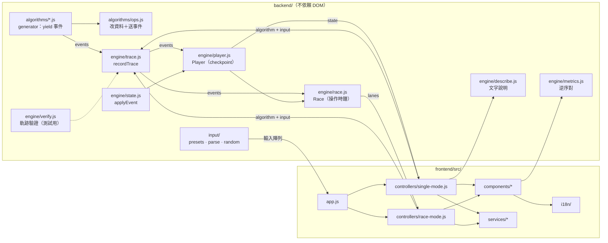
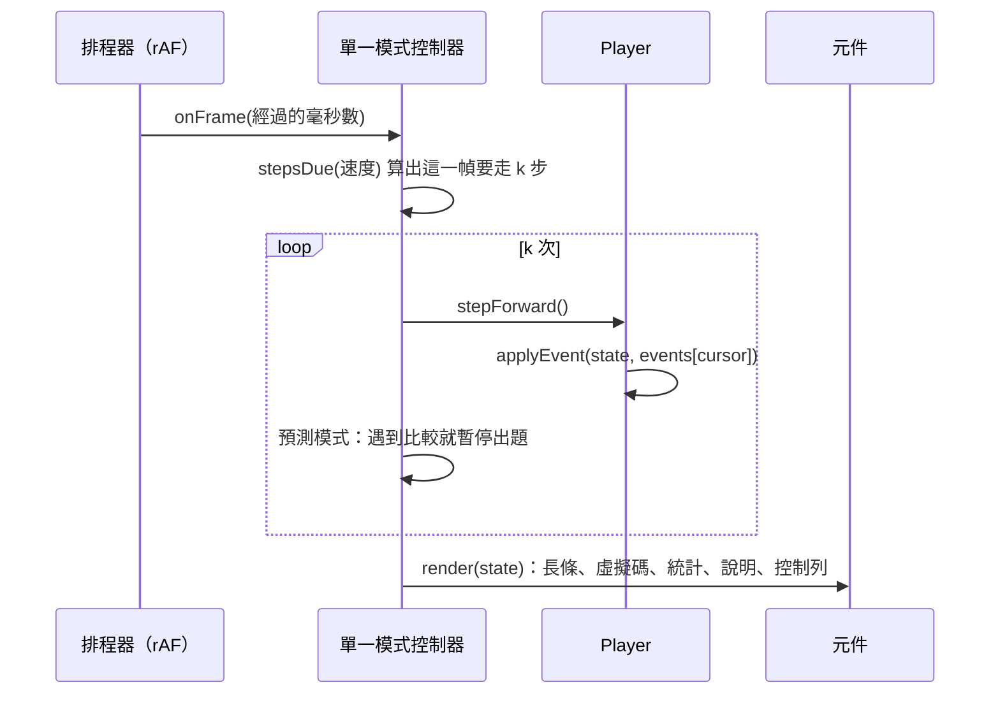

# 架構設計

## 1. 概觀

程式分成三層，依賴方向只往下：

1. **演算法**（`backend/algorithms/`）：每個排序演算法是一個 generator，邊排序邊 `yield` 事件（比較、交換、寫入……），完全不知道畫面長什麼樣子。
2. **引擎**（`backend/engine/`、`backend/input/`）：把事件錄成軌跡（trace），在任意位置重建畫面需要的狀態，負責逐步播放、倒退、比較模式的共同時鐘，以及每一步的文字說明。
3. **介面**（`frontend/src/`）：控制器把引擎狀態交給元件繪製，服務層處理計時、音效、偏好設定、主題、分享連結與快捷鍵。

`backend/` 沿用課程規定的資料夾名稱，裡面是純 JavaScript、不依賴 DOM 的排序核心，前端直接以 ES 模組匯入，Node 也能直接測試。v1 中前後端各有一份重複的氣泡排序，v2 只保留這一份。

## 2. 模組與資料流

一次播放畫面（每個 `requestAnimationFrame`）的流程：

## 3. 事件模型

演算法透過 `ops.js` 的輔助 generator 改資料，例如 `yield* swap(a, i, j, line)` 會同時交換陣列並送出 `swap` 事件，因此「實際做的事」和「送出的事件」不會不一致。每個事件都帶 `line`，指向虛擬碼的行號（從 1 起算）。

| 事件 | 欄位 | 意義 | 改變資料 | 比較模式成本 |
|---|---|---|---|---|
| `compare` | `i, j, target` | 比較兩個元素（`target` 為 `main` 或 `aux`） | 否 | 1 |
| `swap` | `i, j` | 交換主陣列兩個元素 | 是 | 1 |
| `write` | `i, value, from` | 把值寫入主陣列；`from` 是讀取的輔助陣列位置 | 是 | 1 |
| `auxInit` | `size, kind, base` | 建立（`size` 0 為釋放）輔助陣列：`buffer`、`count`、`bucket` | 是 | 0 |
| `auxCopy` | `lo, hi` | 把主陣列一段複製到暫存陣列（合併排序） | 是 | `hi − lo + 1` |
| `auxWrite` | `k, value, from` | 寫入輔助陣列（計數、分桶） | 是 | 1 |
| `sorted` | `indices` | 這些位置已在最終位置 | 否 | 0 |
| `pivot` | `i` | 標示樞紐（`null` 清除） | 否 | 0 |
| `range` | `lo, hi` | 目前處理的區間，區間外變淡 | 否 | 0 |
| `mark` | `role, i` | 指標標籤（`min`、`boundary`） | 否 | 0 |
| `phase` | `name, value` | 階段說明（第幾輪、間隔 h、建堆……） | 否 | 0 |

`describe.js` 把「最後一個事件＋目前狀態」轉成 `{ key, params }`，由 i18n 翻成中文或英文，所以引擎本身不含任何語言文字。

## 4. 播放引擎

- **錄製**：`recordTrace` 在演算法自己的陣列副本上執行 generator，收集全部事件（上限 200 萬個，防止無窮迴圈）。資料量 100 時，氣泡排序約有 7,700（隨機）到 10,100（反向）個事件，錄製不到 10 毫秒。
- **前進**：`stepForward` 對目前狀態套用下一個事件，O(1)。
- **倒退與跳轉**：建構 `Player` 時每 64 個事件存一份狀態快照（checkpoint）。`seek(t)` 從 `⌊t / 64⌋` 的快照複製後重播最多 63 個事件，所以任何位置的成本都有上限（實測平均約 0.01 毫秒），不需要為每種事件寫「反向操作」。
- **一致性**：`verify.js` 檢查每個事件格式正確、重播結果等於排序結果，且被標成「已就定位」的元素之後不再被交換或寫入；單元測試對所有演算法、上百組資料執行這個檢查。

## 5. 比較模式

公平的比較不能用「事件數」：`pivot`、`range` 這類純視覺事件不代表工作量。`race.js` 為每條跑道計算成本的前綴和 `cum[c]`（前 c 個事件的操作數），在共同時間 `t` 時，每條跑道顯示 `cum[c] ≤ t` 的最大 `c`（二分搜尋）。因此倒退、跳轉、播放都只是改變 `t`，名次則依總操作數排序，相同者並列。

## 6. 介面

| 模組 | 職責 |
|---|---|
| `app.js` | 讀取偏好設定與分享連結、管理共用資料、切換模式、語言與主題、全域快捷鍵 |
| `controllers/single-mode.js` | 錄製軌跡、播放迴圈、預測模式、同步所有面板 |
| `controllers/race-mode.js` | 建立多條跑道、共同時鐘的播放與控制 |
| `components/bar-chart.js` | 以 DOM 長條繪製主陣列與輔助陣列，重複使用節點，只更新有變的屬性 |
| `components/highlights.js` | 純函式：依事件與狀態決定每根長條的顏色、是否變淡、標籤 |
| `components/*-panel.js` | 虛擬碼、統計、演算法資訊、資料輸入、預測題目 |
| `services/scheduler.js` | 速度表與 `requestAnimationFrame` 迴圈，把經過時間換成整數步數 |
| `services/share-link.js` | 把設定編碼成網址參數，解析時逐欄驗證 |
| `services/shortcuts.js` | 純函式：按鍵 → 動作，並排除文字欄位、按鈕、滑桿自己的按鍵 |
| `services/sound.js`、`storage.js`、`theme.js` | WebAudio 音效、localStorage 偏好、深淺色主題 |
| `i18n/` | 繁體中文（預設）與英文字典，`{name}` 參數與巢狀訊息 |

長條狀態顏色：比較＝黃、交換＝紅、寫入＝紫、已就定位＝綠、樞紐＝藍，淺色與深色主題各有一組色階，並以色盲模擬檢查同時會出現的顏色組合；另外以符號（⇄、↓、?）與文字標籤補充，不只依賴顏色。

## 7. 設計決策

| 決策 | 理由 | 放棄的做法 |
|---|---|---|
| 演算法寫成 generator、送出型別化事件 | 演算法程式接近課本寫法；同一份事件可用於播放、比較、測試、文字說明 | 每個演算法自己操作 DOM 或 `setTimeout`（v1 做法，無法倒退也難以測試） |
| 先錄完整軌跡再播放 | 可以知道總步數、做時間軸與倒退、預先算出比較模式的名次 | 邊執行邊畫（無法倒退） |
| checkpoint＋重播 | 實作簡單、不容易出錯，倒退成本有上限 | 為每種事件寫反向操作（容易漏掉狀態） |
| 不使用框架、沒有建置步驟 | GitHub Pages 直接發布原始檔，助教與組員不必安裝工具就能讀程式 | React／Vite 等需要打包的做法 |
| DOM 長條而非 canvas | 資料量最多 100，DOM 夠快，而且可用 CSS 主題、文字標籤與無障礙屬性 | canvas（需要自己處理縮放、主題與文字） |

## 8. 新增一個演算法

1. 在 `backend/algorithms/` 新增檔案：寫出虛擬碼陣列與 generator，資料變動一律透過 `ops.js`，適當送出 `sorted` 事件。
2. 匯出 `{ id, sort, pseudocode, complexity, stable, inPlace, adaptive, comparison, predict }`，並加入 `index.js` 的清單。
3. 在 `frontend/src/i18n/zh-Hant.js` 與 `en.js` 加上 `algo.<id>.name/short/desc/tip`。
4. 執行 `npm test`：現有測試會自動對新演算法做正確性、事件格式、「已就定位」不變量與文字說明的檢查。
